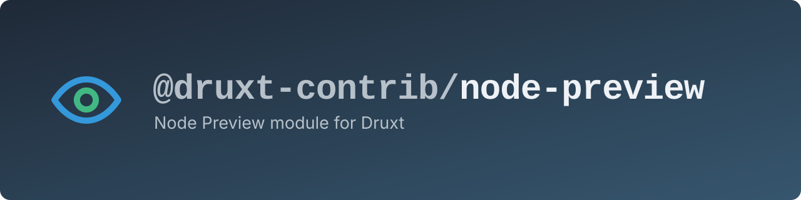
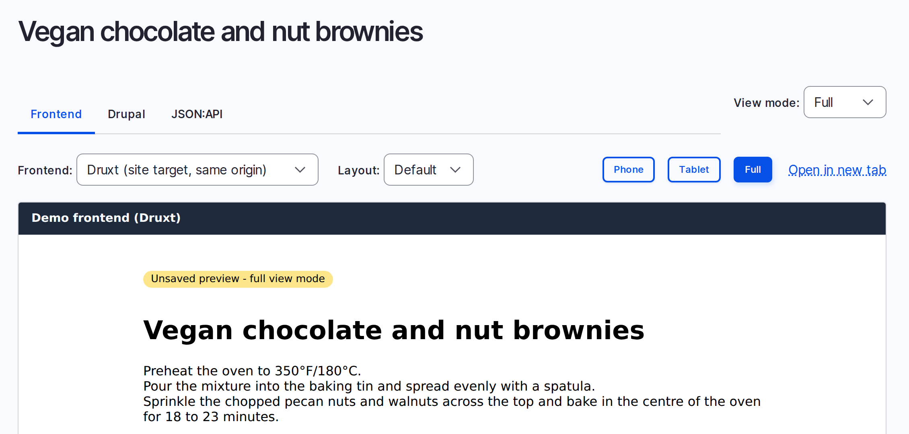

<!-- vale off -->
<!-- The alt text describes what the banner shows: the @druxt-contrib/node-preview mark, name and description. The name-colon-description form trips ColonUsage. -->
<a href="https://druxtjs.org">
  
</a>
<!-- vale on -->

# @druxt-contrib/node-preview

[](https://www.npmjs.com/package/@druxt-contrib/node-preview)
[](https://github.com/druxt-contrib/druxt-node-preview/actions/workflows/ci.yml)
[](https://discord.druxtjs.org)

> Node Preview module for Druxt

Shows an unsaved Drupal node in your [Druxt](https://druxtjs.org) frontend.
The editor presses Preview in Drupal and sees the node as the live site will
show it, paragraphs included.



## Contents

- [Features](#features)
- [How it works](#how-it-works)
- [Requirements](#requirements)
- [Quick start](#quick-start)
- [Options](#options)
- [Troubleshooting](#troubleshooting)
- [More documentation](#more-documentation)

## Features

- Renders the unsaved node with the site's own Druxt components.
- Includes unsaved paragraphs, and the media they reference.
- Lets the editor pick a Nuxt layout, such as a bare one for embedded content.
- Wraps the preview in a component of your own, for a title or a container.
- Reads the preview with a Simple OAuth token on a frontend on another domain.
- Can add its own preview target to Drupal each time Nuxt starts up.

## How it works

1. The editor presses Preview in Drupal. The Frontend tab of
   [Consumer Node Preview](https://www.drupal.org/project/consumer_node_preview)
   opens this module's page in a frame.
2. The page reads the preview's JSON:API address from the part of its URL
   after the `#`. Browsers do not send that part to the frontend's server.
3. The page fetches the preview, from
   [JSON:API Node Preview](https://www.drupal.org/project/jsonapi_node_preview),
   with the editor's Drupal session, or with a token from the URL for a
   frontend on another domain. It puts the document in the Druxt store.
4. `DruxtEntity` renders the node from the store. The unsaved content goes
   through the same components as the live site.

## Requirements

- Nuxt 2, with Druxt 0.25 and Druxt Entity 0.29 or later, through `druxt-site`
  0.15.
- Node 16 for the build. Druxt's schema build fails on newer Node.
- Drupal 10.3 or 11, with Consumer Node Preview and JSON:API Node Preview. See
  [Consumer Node Preview's requirements](https://git.drupalcode.org/project/consumer_node_preview/-/blob/1.0.x/README.md#requirements)
  for the JSON:API Node Preview fixes it needs.
- The frontend and Drupal on one parent domain, such as `www.example.com` and
  `cms.example.com`. Otherwise, see [Previews with a
  token](docs/preview-request.md#previews-with-a-token).

## Quick start

On the frontend:

```sh
npm install druxt-site @druxt-contrib/node-preview
```

```js
// nuxt.config.js
export default {
  modules: ['@druxt-contrib/node-preview', 'druxt-site'],
  druxt: {
    baseUrl: 'https://cms.example.com',
  },
}
```

A site without `druxt-site` lists `druxt-entity` in `modules` instead.

On Drupal:

1. Install the modules:

   ```sh
   composer require drupal/jsonapi_node_preview:^1.0@beta drupal/consumer_node_preview
   drush en consumer_node_preview
   ```

2. Go to **Administration > Configuration > Web services > Consumers**, and
   add or edit the frontend's consumer. Under **Preview targets**, add a label
   and this URL, with your frontend's host:

   ```text
   https://www.example.com/druxt/node/preview?vm=[view_mode]#[jsonapi_node_preview_path]
   ```

   Drupal fills in the parts in square brackets when the editor presses
   Preview. Keep them as they are. The frontend can also add this target
   itself. See [Automatic registration](docs/registration.md).

3. Allow the frontend's origin, with credentials, in the CORS settings in
   `services.yml`. [Consumer Node Preview's
   configuration](https://git.drupalcode.org/project/consumer_node_preview/-/blob/1.0.x/README.md#configuration)
   has the YAML.
4. Let Drupal show the preview page in a frame. On the preview page's route
   only, remove any `X-Frame-Options` header, and add Drupal's origin to its
   `frame-ancestors` rule. Keep the frontend's other pages as they are.

To check it, edit a node, change something and press Preview. The Frontend
tab shows the change.

## Options

All options are optional, and go under `druxt.nodePreview`.

| Option     | Default                 | Description                                                                                                   |
| ---------- | ----------------------- | ------------------------------------------------------------------------------------------------------------- |
| `path`     | `'/druxt/node/preview'` | The preview page's path.                                                                                      |
| `include`  | `[]`                    | Relationships to add to the preview request. Key them by type when only some bundles have them.               |
| `origins`  | `[]`                    | More origins the preview may come from, as full URLs.                                                         |
| `layouts`  | `[]`                    | Nuxt layouts the preview may use. See [Layouts and theming](docs/layouts-and-theming.md).                     |
| `register` | `false`                 | Adds the frontend's preview target to Drupal on start up. See [Automatic registration](docs/registration.md). |

**include.** Consumer Node Preview already includes a node's paragraphs. Add
what the paragraphs reference, such as `field_content.field_media`. JSON:API
refuses a path that the previewed type does not have, so key it by type when
only some bundles have it:

```js
include: { 'node--page': ['field_content.field_media'] }
```

**origins.** Any link can put an address in the page's URL. So the page only
fetches from this site, from `druxt.baseUrl`, and from `origins`. A request to
an origin in `origins` goes without the Druxt client, whose headers and auth
are for `druxt.baseUrl`. An origin whose host has characters other than
letters, digits, dots and hyphens is ignored.

A value the module cannot use shows a warning in the build output, and the
module ignores it.

## Troubleshooting

The page shows "Preview unavailable" and a message.

- **HTTP 404.** Drupal has no preview of this node for the editor. Check that
  the editor pressed Preview, and that the frontend and Drupal share a parent
  domain. On your own computer, use one host name for both: `localhost` and
  `127.0.0.1` count as different. Then check the CORS settings.
- **"The preview endpoint is not on this site or its Drupal site".** Add the
  preview's origin to the `origins` option.
- **"The URL fragment has no preview endpoint".** Make the target URL end in
  `#[jsonapi_node_preview_path]` or `#[jsonapi_node_preview]`.
- **HTTP 400.** An `include` path that the previewed type does not have. Key
  that path by type.

If the Frontend tab stays blank, check the frame headers from step 4 of the
[Quick start](#quick-start), because the frontend refused the frame.

For automatic registration and schema errors, see
[Troubleshooting](docs/troubleshooting.md).

## More documentation

- [Automatic registration](docs/registration.md), and its [Drupal
  setup](docs/registration-drupal-setup.md)
- [Layouts and theming](docs/layouts-and-theming.md)
- [The preview request](docs/preview-request.md), including previews with a
  token
- [Troubleshooting](docs/troubleshooting.md)
- [Writing another frontend](docs/other-frontends.md)

The [example](https://github.com/druxt-contrib/druxt-node-preview/tree/0.x/example)
pairs a Drupal site and a Nuxt site.

## Licence

MIT.
